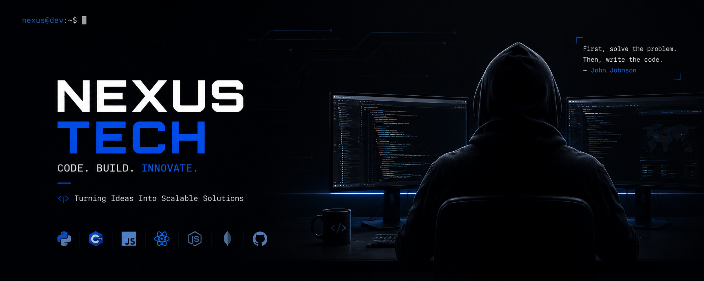
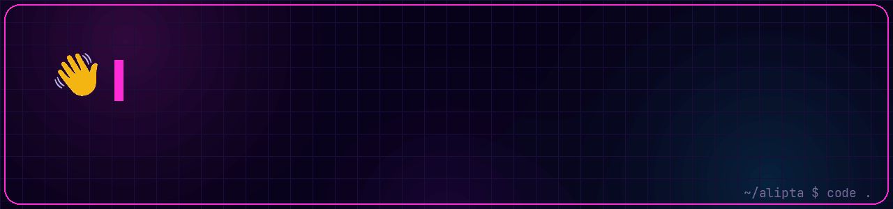
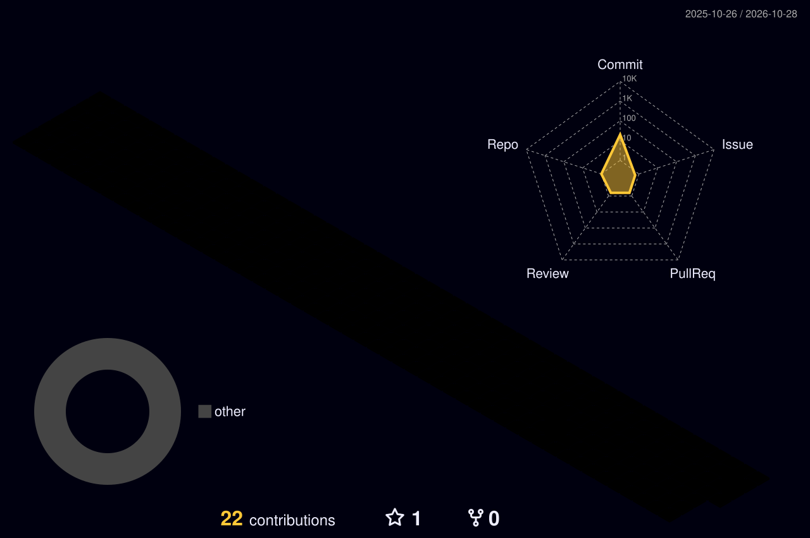
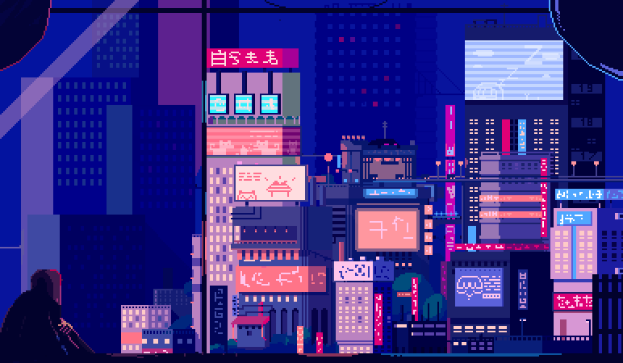
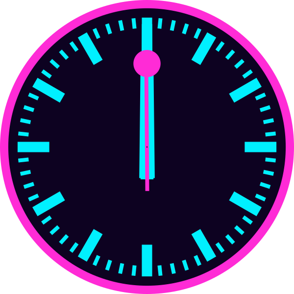

<!-- Banner -->
<div align="center">
  
</div>

<br>

<!-- Hero -->
<div align="center">
  <picture>
    <source media="(prefers-color-scheme: dark)" srcset="./dark.svg">
    <source media="(prefers-color-scheme: light)" srcset="./light.svg">
    
  </picture>
</div>

<br>

<div align="center">
  <picture>
    <source media="(prefers-color-scheme: dark)" srcset="./images/intro-dark.gif">
    <source media="(prefers-color-scheme: light)" srcset="./images/intro-light.gif">
    
  </picture>
</div>

<p align="center">
  <a href="mailto:nexustech933@gmail.com"></a>
  <br>
  <b>✨ <a href="mailto:nexustech933@gmail.com">nexustech933@gmail.com</a> ✨</b>
</p>

---

## 𝐇𝐞𝐥𝐥𝐨 𝐭𝐡𝐞𝐫𝐞, 𝐟𝐞𝐥𝐥𝐨𝐰 <𝚌𝚘𝚍𝚎𝚛 />! 

<br clear="right">


> [!CAUTION]
> - 🔖 Congratulations, you found me!

> [!NOTE]
> - 💻 Passionate about **Web Development & Programming**

> [!IMPORTANT]
> - 🌱 I'm currently learning **JavaScript, Python, C and Java**

> [!WARNING]
> - ⚡ Fun fact: **Maybe I'm funny 😄**

> [!NOTE]
> - 🌐 My portfolio website: **coming soon!**

> [!IMPORTANT]
> - 🚀 **My projects: coming soon!**
> - 🛠️ I haven't published a project yet. This space is ready for my first one.

> [!TIP]
> - 📗 Want to collaborate or have a question? Reach me at **[nexustech933@gmail.com](mailto:nexustech933@gmail.com)**

<p align="center">
  <a href="mailto:nexustech933@gmail.com"></a>
  <a href="https://github.com/Nexus-Tech114"></a>
  <a href="https://x.com/nexustech114"></a>
  <a href="https://www.linkedin.com/in/nexus-tech/"></a>
  <a href="https://www.instagram.com/nexus_tech114/"></a>
</p>

---

### 🎯 Focus

<p>
  
  
  
  
</p>

<h3 align="left">Connect with me:</h3>
<p align="left">
<a href="https://github.com/Nexus-Tech114" target="blank"></a>
<a href="mailto:nexustech933@gmail.com" target="blank"></a>
<a href="https://www.instagram.com/nexus_tech114/" target="blank"></a>
<a href="https://www.linkedin.com/in/nexus-tech/" target="blank"></a>
<a href="https://x.com/nexustech114" target="blank"></a>
</p>

<br>

<h3 align="left">Languages and Tools:</h3>

- Languages
<p align="left">
  <a href="https://skillicons.dev">
    
  </a>
</p>

- Tools
<p align="left">
  <a href="https://skillicons.dev">
    
  </a>
</p>

---

<h3 align="center">📁 Projects</h3>

<p align="center">
  
</p>

<p align="center">
  <i>No public projects yet. Watch this space for my first one. 👀</i>
</p>

---

<h3 align="center">📈 GitHub Stats</h3>

<p align="center">
  <a href="https://github.com/Nexus-Tech114"></a>
</p>

<details open align="center">
  <summary>📊 More Stats</summary>
  <br>
  <div align="center">
    <a href="https://github.com/Nexus-Tech114"></a>
    <br><br>
    <a href="https://github.com/Nexus-Tech114"></a>
    <a href="https://github.com/Nexus-Tech114"></a>
  </div>
</details>

---

<h3 align="center">📊 GitHub Contributions</h3>

<p align="center">
  <picture>
    <source media="(prefers-color-scheme: dark)" srcset="./profile-3d-contrib/profile-night-rainbow.svg">
    <source media="(prefers-color-scheme: light)" srcset="./profile-3d-contrib/profile-gitblock.svg">
    
  </picture>
</p>

<p align="center">
  <picture>
    <source media="(prefers-color-scheme: dark)" srcset="https://raw.githubusercontent.com/Nexus-Tech114/Nexus-Tech114/output/github-snake-dark.svg">
    <source media="(prefers-color-scheme: light)" srcset="https://raw.githubusercontent.com/Nexus-Tech114/Nexus-Tech114/output/github-snake.svg">
    
  </picture>
</p>

<p align="center">
  <picture>
    <source media="(prefers-color-scheme: dark)" srcset="https://raw.githubusercontent.com/Nexus-Tech114/Nexus-Tech114/pacman/pacman-contribution-graph-dark.svg">
    <source media="(prefers-color-scheme: light)" srcset="https://raw.githubusercontent.com/Nexus-Tech114/Nexus-Tech114/pacman/pacman-contribution-graph.svg">
    
  </picture>
</p>





<h2 align="center">【H o b b i e s】</h2>


<br clear="both">

<p align="center">
  💻 Coding &nbsp;·&nbsp; 🌐 Web Development &nbsp;·&nbsp; 📚 Learning
</p>

<details open align="center">
  <summary>💙 More</summary>
  <br>
  <div align="center">
    
    <br><br>
    
    <br><br>
    <p>⏳ 𝚈𝚘𝚞 𝚑𝚊𝚟𝚎 𝚜𝚝𝚊𝚢𝚎𝚍 𝚘𝚗 𝚖𝚢 𝚙𝚛𝚘𝚏𝚒𝚕𝚎 𝚏𝚘𝚛 ◔_◔ ⌛</p>
    
    <br><br>
    
  </div>
</details>


<div align="center">

```diff
+@ @ @ @ @ @ @ @ @ @ @ @ @ @ @ @ @ @ @ @ @ @ @ @ @ @ @ @+
@@       o o                                           @@
@@       | |                                           @@
@@      _L_L_                                          @@
@@   ❮\/__-__\/❯  A habit missed once is a mistake,    @@
@@   ❮(|~o.o~|)❯    A habit missed twice is a start    @@
@@   ❮/ \`-'/ \❯          of new habit!                @@
@@     _/`U'\_                                         @@
@@    ( .   . )     .----------------------------.     @@
@@   / /     \ \    | while( ! (succed=try() ) ) |     @@
@@   \ |  ,  | /    '----------------------------'     @@
@@    \|=====|/                                        @@
@@     |_.^._|                                         @@
@@     | |"| |                                         @@
@@     ( ) ( )   Testing leads to failure              @@
@@     |_| |_|   and failure leads to understanding    @@
@@ _.-' _j L_ '-._                                     @@
@@(___.'     '.___)                                    @@
+@ @ @ @ @ @ @ @ @ @ @ @ @ @ @ @ @ @ @ @ @ @ @ @ @ @ @ @+
```

</div>


<p align="center">
  
</p>

<p align="center">
  
</p>
