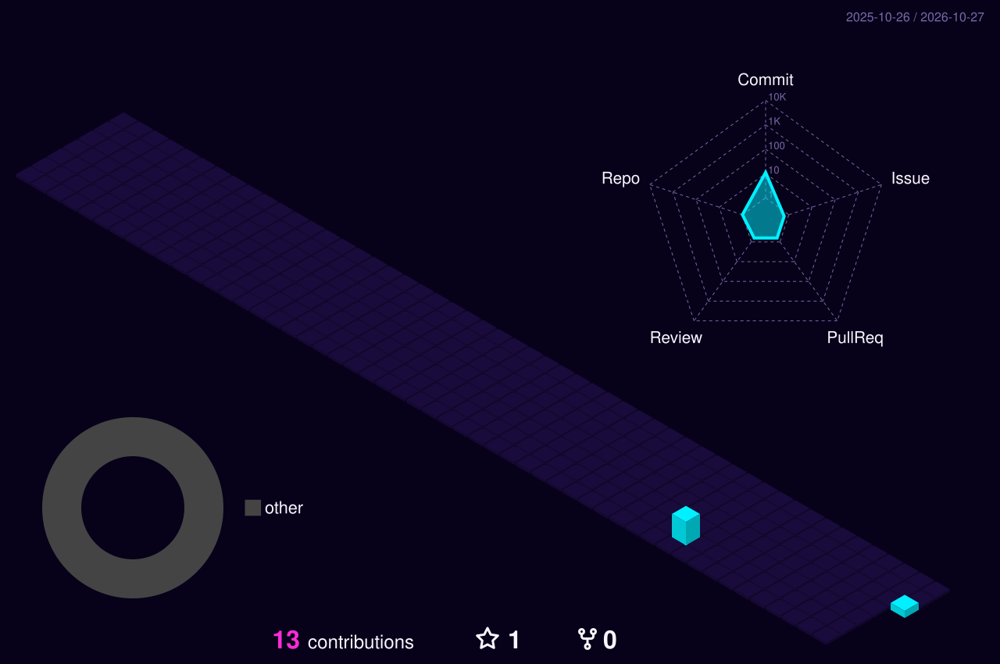

<!-- Banner -->
<div align="center">
</div>

<br>

<!-- Hero -->
<div align="center">
  <picture>
    <source media="(prefers-color-scheme: dark)" srcset="./dark.svg">
    <source media="(prefers-color-scheme: light)" srcset="./light.svg">
    
  </picture>
</div>

<br>

<div align="center">
  <picture>
    <source media="(prefers-color-scheme: dark)" srcset="./images/intro-dark.gif">
    <source media="(prefers-color-scheme: light)" srcset="./images/intro-light.gif">
    
  </picture>
</div>

<p align="center">
  <a href="mailto:nexustech933@gmail.com"></a>
  <br>
  <b>✨ <a href="mailto:nexustech933@gmail.com">nexustech933@gmail.com</a> ✨</b>
</p>

---

## Hey, I'm Alipta!  💻 

<br clear="right">


 **Learning to code, building cool things, and turning ideas into reality.**

I'm a computer science student who enjoys exploring how technology works and creating things with code. I'm still growing as a developer, but every bug I fix and every concept I learn takes me one step forward.

I believe in **learning by building, improving through practice, and never stopping at “it works.”** 

<br clear="right">


###  My Developer Journey

- 💻 **Currently know:** C, HTML, and JavaScript
- 🌱 **Currently exploring:** Python, Node.js, and MongoDB
- 🎯 **My goal:** Become a skilled software engineer and build projects that solve real problems.
- 🛠️ **My approach:** Learn the fundamentals, experiment with ideas, make mistakes, and keep improving.

<p align="left">
  <b>Know</b>&nbsp;&nbsp;
  &nbsp;&nbsp;
  <b>Exploring</b>&nbsp;&nbsp;
  <br>
  <b>Tools</b>&nbsp;&nbsp;
</p>

> [!NOTE]
> I'm not here to pretend I know everything. I'm here to learn, build, share my progress, and become better with every project. 🌱

> [!IMPORTANT]
> **Current mission:** Strengthen my programming fundamentals, explore frontend and backend development, and turn what I learn into real projects.

> [!TIP]
> I enjoy creating websites, solving programming problems, exploring new technologies, and discovering better ways to build things. Outside coding, music is my escape — especially **Arijit Singh**. 🎧 

> [!WARNING]
> Side effects of coding may include chasing bugs, asking “why isn't this working?”, and celebrating when a single line finally works. 😂


### 🚧 What's Coming Next?

🌐 **Portfolio:** In progress — building something that represents my journey.

🚀 **Projects:** I'm working toward publishing projects that demonstrate what I learn, from programming fundamentals to web development.

📚 **Learning in public:** This profile is my coding journey, not just a showcase. Expect experiments, improvements, new skills, and progress one commit at a time.


###  Let's Connect!

Have an idea, a suggestion, or an interesting project? I'm always happy to connect with fellow learners and developers.

📩 **Email:** [nexustech933@gmail.com](mailto:nexustech933@gmail.com)

<p align="left">
<a href="https://github.com/Nexus-Tech114" target="blank"></a>
<a href="mailto:nexustech933@gmail.com" target="blank"></a>
<a href="https://www.instagram.com/nexus_tech114/" target="blank"></a>
<a href="https://www.linkedin.com/in/nexus-tech/" target="blank"></a>
<a href="https://x.com/nexustech114" target="blank"></a>
</p>

<p align="center">
   Thanks for stopping by! Explore my repositories, follow my progress, and let's keep building.
  <br><br>
  <b>Code. Learn. Build. Repeat.</b> 
</p>

---

<h3 align="center">📈 GitHub Stats</h3>

<p align="center">
  <a href="https://github.com/Nexus-Tech114"></a>
</p>

<details open align="center">
  <summary>📊 More Stats</summary>
  <br>
  <div align="center">
    <a href="https://github.com/Nexus-Tech114"></a>
    <br><br>
    <a href="https://github.com/Nexus-Tech114"></a>
    <a href="https://github.com/Nexus-Tech114"></a>
  </div>
</details>

---

<h3 align="center">📊 GitHub Contributions</h3>

<p align="center">
  <picture>
    <source media="(prefers-color-scheme: dark)" srcset="./profile-3d-contrib/profile-midnight-neon.svg">
    <source media="(prefers-color-scheme: light)" srcset="./profile-3d-contrib/profile-gitblock.svg">
    
  </picture>
</p>

<p align="center">
  <picture>
    <source media="(prefers-color-scheme: dark)" srcset="https://raw.githubusercontent.com/Nexus-Tech114/Nexus-Tech114/output/github-snake-dark.svg">
    <source media="(prefers-color-scheme: light)" srcset="https://raw.githubusercontent.com/Nexus-Tech114/Nexus-Tech114/output/github-snake.svg">
    
  </picture>
</p>

<p align="center">
  <picture>
    <source media="(prefers-color-scheme: dark)" srcset="https://raw.githubusercontent.com/Nexus-Tech114/Nexus-Tech114/pacman/pacman-contribution-graph-dark.svg">
    <source media="(prefers-color-scheme: light)" srcset="https://raw.githubusercontent.com/Nexus-Tech114/Nexus-Tech114/pacman/pacman-contribution-graph.svg">
    
  </picture>
</p>


<h2 align="center">【Hobbies】</h2>


<br clear="both">

<p align="center">
  🎧 Music &nbsp;·&nbsp; 💻 Coding &nbsp;·&nbsp; 🌐 Web Development &nbsp;·&nbsp; 📚 Learning
</p>

<p align="center">
  🎶 <b>Die-hard Arijit Singh fan</b> 🎶
</p>

<p align="center">
  
</p>

<details open align="center">
  <summary>💜 More</summary>
  <br>
  <div align="center">
    
    <br><br>
    
    <br><br>
    <p>⏳ 𝚈𝚘𝚞 𝚑𝚊𝚟𝚎 𝚜𝚝𝚊𝚢𝚎𝚍 𝚘𝚗 𝚖𝚢 𝚙𝚛𝚘𝚏𝚒𝚕𝚎 𝚏𝚘𝚛 ◔_◔ ⌛</p>
    
    <br><br>
    
  </div>
</details>


<div align="center">

```diff
+@ @ @ @ @ @ @ @ @ @ @ @ @ @ @ @ @ @ @ @ @ @ @ @ @ @ @ @+
@@       o o                                           @@
@@       | |                                           @@
@@      _L_L_                                          @@
@@   ❮\/__-__\/❯  A habit missed once is a mistake,    @@
@@   ❮(|~o.o~|)❯    A habit missed twice is a start    @@
@@   ❮/ \`-'/ \❯          of new habit!                @@
@@     _/`U'\_                                         @@
@@    ( .   . )     .----------------------------.     @@
@@   / /     \ \    | while( ! (succed=try() ) ) |     @@
@@   \ |  ,  | /    '----------------------------'     @@
@@    \|=====|/                                        @@
@@     |_.^._|                                         @@
@@     | |"| |                                         @@
@@     ( ) ( )   Testing leads to failure              @@
@@     |_| |_|   and failure leads to understanding    @@
@@ _.-' _j L_ '-._                                     @@
@@(___.'     '.___)                                    @@
+@ @ @ @ @ @ @ @ @ @ @ @ @ @ @ @ @ @ @ @ @ @ @ @ @ @ @ @+
```

</div>


<p align="center">
  
</p>

<p align="center">
  
</p>
